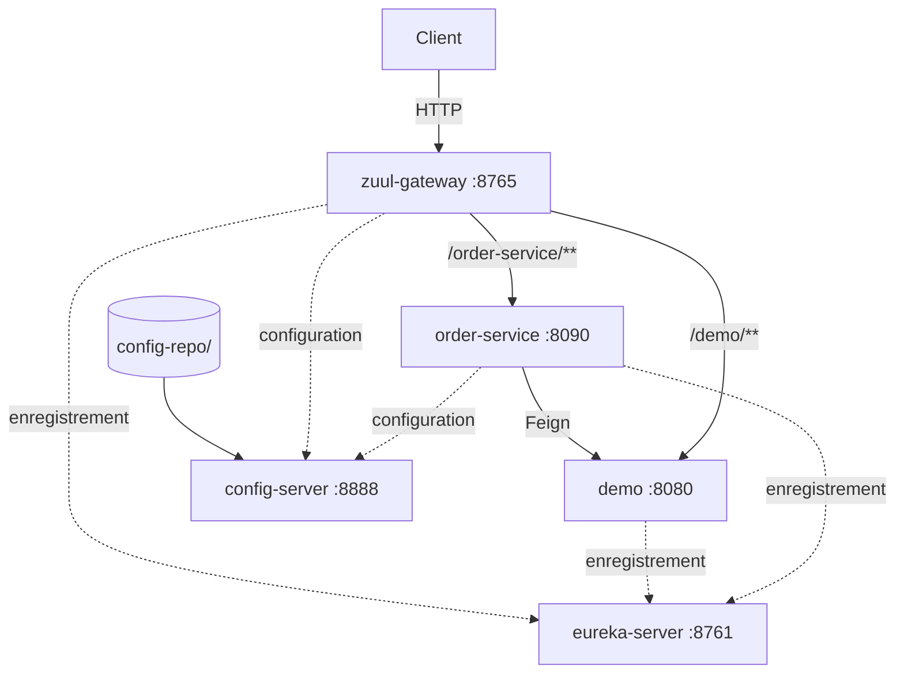

# TP5 – Configuration centralisée et conteneurisation

Microservices avec **Spring Boot / Spring Cloud** : Eureka, Config Server, OpenFeign, Resilience4j, API Gateway Zuul et Docker Compose.

## 1. Introduction et objectifs

Ce TP met en place une configuration centralisée avec Spring Cloud Config, puis conteneurise toute l'architecture avec Docker Compose. Il prolonge les TP précédents : Eureka (TP2), Feign (TP3) et Resilience4j (TP4).

Objectifs :

1. Créer un **Config Server** qui centralise les fichiers de configuration.
2. Connecter `order-service` au Config Server pour qu'il récupère sa configuration au démarrage.
3. Écrire un **Dockerfile** pour chaque microservice.
4. Écrire un **docker-compose.yml** qui orchestre tous les conteneurs.
5. Démarrer l'ensemble avec `docker-compose up`.

En complément, une **API Gateway Zuul** sert de point d'entrée unique.

**Environnement :** Windows, VS Code, Docker Desktop, Maven (wrapper `mvnw`). Services en Java 21 / Spring Boot 3.3.5 / Spring Cloud 2023.0.3. Seule la gateway Zuul est en Java 11 / Spring Boot 2.3.12 (voir section 6).

## 2. Architecture

| Service | Port | Rôle |
| --- | --- | --- |
| `eureka-server` | 8761 | Registre des services |
| `config-server` | 8888 | Sert la configuration depuis `config-repo/` |
| `demo` | 8080 | Service exposant `/hello` |
| `order-service` | 8090 | Appelle `demo` avec Feign, protégé par Resilience4j |
| `zuul-gateway` | 8765 | Point d'entrée unique, routes vers `order-service` et `demo` |



Le client n'appelle que `zuul-gateway`, qui résout les adresses des services dans Eureka. `order-service` et `zuul-gateway` lisent leur configuration dans `config-repo/` via le Config Server.

Structure du projet sur le disque :


Arborescence :

```
microservices-tp5/
├── docker-compose.yml
├── config-repo/                          dépôt de configuration (backend "native")
│   ├── order-service.properties          profil par défaut (localhost)
│   ├── order-service-docker.properties   profil "docker" (eureka-server)
│   ├── zuul-gateway.properties
│   └── zuul-gateway-docker.properties
├── eureka-server/    :8761
├── config-server/    :8888   NOUVEAU (TP5)
├── demo/             :8080
├── order-service/    :8090   bootstrap.properties NOUVEAU, application.properties vidé
└── zuul-gateway/     :8765   API Gateway (Spring Boot 2.3 / Java 11)
```

Chaque service a son `Dockerfile`.

## 3. Config Server et config-repo

Le Config Server utilise le backend **native** (fichiers locaux) ; en production, on utiliserait un dépôt Git (`spring.cloud.config.server.git.uri`).

```java
@SpringBootApplication
@EnableConfigServer
public class ConfigServerApplication {
    public static void main(String[] args) {
        SpringApplication.run(ConfigServerApplication.class, args);
    }
}
```

`application.properties` :

```properties
server.port=8888
spring.application.name=config-server
spring.profiles.active=native
spring.cloud.config.server.native.search-locations=file:./config-repo/
eureka.client.service-url.defaultZone=http://localhost:8761/eureka/
```

Contenu de `config-repo/` :

| Fichier | Rôle |
| --- | --- |
| `order-service.properties` | Profil par défaut : port 8090, Eureka sur `localhost`, Resilience4j, Actuator |
| `order-service-docker.properties` | Profil `docker` : Eureka sur `http://eureka-server:8761/eureka/` |
| `zuul-gateway.properties` | Port 8765, routes Zuul, timeouts |
| `zuul-gateway-docker.properties` | Profil `docker` de la gateway |

Vérification : `http://localhost:8888/order-service/default` et `http://localhost:8888/order-service/docker`.


## 4. order-service, client du Config Server

1. **Dépendances** : `spring-cloud-starter-config`, et avec Spring Boot 3 aussi `spring-cloud-starter-bootstrap` (sans elle, `bootstrap.properties` est ignoré).
2. **`bootstrap.properties`**, chargé avant `application.properties` :

   ```properties
   spring.application.name=order-service
   spring.cloud.config.uri=http://localhost:8888
   spring.cloud.config.fail-fast=true
   ```

3. **`application.properties` vidé** : toute propriété laissée ici aurait priorité sur celles du Config Server.

Ordre de démarrage en local : `eureka-server` (8761), `config-server` (8888), puis `order-service` (8090).

## 5. Conteneurisation

`Dockerfile` (identique pour chaque service ; `openjdk:21-jre-slim` n'existe pas, on utilise `eclipse-temurin`) :

```dockerfile
FROM eclipse-temurin:21-jre
WORKDIR /app
COPY target/*.jar app.jar
ENTRYPOINT ["java", "-jar", "app.jar"]
```

Points clés de `docker-compose.yml` :

- tous les services sont sur le réseau `microservice-network` et se joignent par leur nom (`eureka-server`, `config-server`) ;
- `config-server` monte `./config-repo` sur `/app/config-repo` ;
- `depends_on` impose l'ordre de démarrage ;
- `restart: on-failure` relance `order-service` si le Config Server n'est pas prêt (`fail-fast=true`).

**Piège de priorité** : les propriétés du Config Server écrasent les variables d'environnement. Une variable `EUREKA_CLIENT_SERVICE_URL_DEFAULTZONE` dans le compose serait remplacée par `localhost`. Solution : `SPRING_PROFILES_ACTIVE=docker`, qui charge `order-service-docker.properties`.

## 6. API Gateway Zuul

`zuul-gateway` (port 8765) route vers `order-service` et `demo` via Eureka, et lit sa configuration dans le Config Server.

Zuul 1 a été retiré de Spring Cloud depuis 2020 et ne fonctionne pas avec Spring Boot 3 : la gateway est donc un projet indépendant en **Spring Boot 2.3.12 / Spring Cloud Hoxton.SR12 / Java 11** (image `eclipse-temurin:11-jre`). Son remplaçant actuel est Spring Cloud Gateway.

```java
@SpringBootApplication
@EnableZuulProxy
public class ZuulGatewayApplication {
    public static void main(String[] args) {
        SpringApplication.run(ZuulGatewayApplication.class, args);
    }
}
```

| URL via la gateway | Service appelé |
| --- | --- |
| `http://localhost:8765/order-service/order` | `order-service`, route `/order` |
| `http://localhost:8765/demo/hello` | `demo`, route `/hello` |
| `http://localhost:8765/actuator/routes` | liste des routes |

## 7. Lancer et tester

Générer les JARs (dans chaque projet) puis lancer :

```bat
cd eureka-server && mvnw.cmd clean package -DskipTests && cd ..
cd config-server && mvnw.cmd clean package -DskipTests && cd ..
cd demo          && mvnw.cmd clean package -DskipTests && cd ..
cd order-service && mvnw.cmd clean package -DskipTests && cd ..
cd zuul-gateway  && mvnw.cmd clean package -DskipTests && cd ..

docker-compose up -d --build
docker-compose ps
```

| Test | Attendu |
| --- | --- |
| `docker-compose ps` | 5 conteneurs `Up` |
| http://localhost:8761 | `DEMO`, `ORDER-SERVICE`, `CONFIG-SERVER`, `ZUUL-GATEWAY` enregistrés |
| http://localhost:8888/order-service/docker | propriétés servies |
| http://localhost:8090/order | `Commande créée. Réponse du service demo : Hello, Microservice!` |
| http://localhost:8765/order-service/order | même réponse via la gateway |


Les trois services répondent sur leurs ports. La page « Whitelabel Error Page » (404) est normale : on a ouvert la racine `/`, où aucune route n'est définie. Les vraies routes sont `/order-service/default` (Config Server), `/hello` (demo) et `/order` (order-service).

.png)

.png)

**Disjoncteur (TP4)** : `docker-compose stop demo`, puis au moins 5 appels à `/order` → message de repli et état `OPEN` sur `http://localhost:8090/actuator/circuitbreakers`. Après `docker-compose start demo` et environ 10 secondes : `HALF_OPEN` puis `CLOSED`.


Arrêt : `docker-compose down`.

**Exécution locale sans Docker** (dans cet ordre) : `eureka-server` (8761), `config-server` (8888), `demo` (8080), `order-service` (8090), puis `zuul-gateway` (8765). Le Config Server cherche `file:./config-repo/` : le lancer depuis la racine du projet.

```bat
java -jar config-server\target\config-server-0.0.1-SNAPSHOT.jar
```

## 8. Difficultés rencontrées et solutions

| Problème | Cause | Solution |
| --- | --- | --- |
| `openjdk:21-jre-slim` introuvable | l'image n'existe pas | `eclipse-temurin:21-jre` |
| `bootstrap.properties` ignoré | Spring Boot 3 ne le charge plus par défaut | `spring-cloud-starter-bootstrap` |
| `order-service` garde l'URL Eureka `localhost` dans Docker | le Config Server a priorité sur les variables d'environnement | profil `docker` |
| `package org.junit.jupiter.api does not exist` | ancien `pom.xml` sans `spring-boot-starter-test` ; `-DskipTests` saute l'exécution mais pas la compilation des tests | `pom.xml` alignés sur Spring Boot 3.3.5 |
| `mvnw` introuvable | wrapper absent de certains projets | copie de `.mvn` et `mvnw.cmd` |
| Maven dans Docker sans Internet | proxy de Docker Desktop non pris en compte | wrapper Maven local |
| `lstat /target: no such file or directory` | JARs non générés | `mvnw.cmd clean package -DskipTests` |
| `container name ... already in use` | conteneurs d'un essai précédent | `docker rm -f eureka-server config-server demo order-service` |
| Whitelabel Error Page (404) | racine `/` sans route | tester `/hello`, `/order`, `/order-service/default` |
| Zuul incompatible avec Spring Boot 3 | Zuul 1 retiré de Spring Cloud 2020+ | gateway séparée en Spring Boot 2.3.12 / Java 11 |


 


## 9. Conclusion

La configuration d'`order-service` est centralisée dans le Config Server, et toute l'architecture (Eureka, Config Server, `demo`, `order-service`, Zuul) démarre avec `docker-compose up -d --build`.

À retenir : la configuration vit dans `config-repo/` ; les propriétés du Config Server l'emportent sur les variables d'environnement (d'où le profil `docker`) ; les conteneurs se joignent par leur nom de service et jamais par `localhost`. En production, le backend *native* serait remplacé par un dépôt Git, et Zuul par Spring Cloud Gateway.
